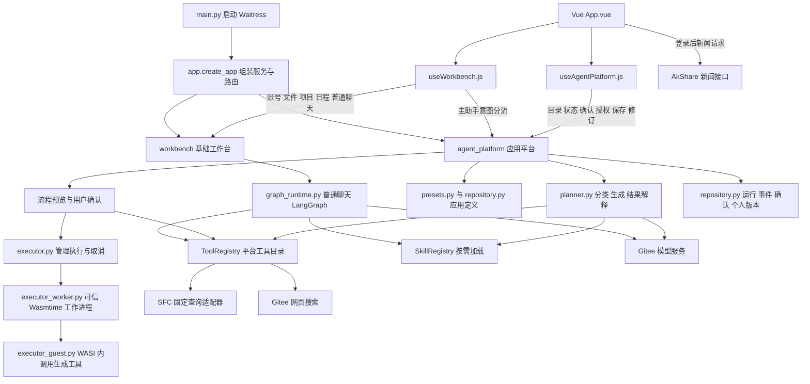

# 成都八零 AI 原生金融应用平台

**让每个人都能创造自己的金融工具。**

GitHub 源码的收录范围和新电脑安装步骤见 [GitHub 上传说明](docs/GitHub上传说明.md)。数据库、真实 `.env`、账号和聊天记录、依赖环境及本机验收产物不随仓库发布；下文所述完整本机副本含这些内容，克隆源码后需按说明另行配置和恢复数据。

成都八零面向个人金融研究者、策略创作者、财经学习者和金融应用开发者。用户既可以普通对话，也可以提出具体需求，由主 agent 调用已有应用，或生成一个包含流程、提示词、Python 工具和 skill 的 sub-agent。

平台先明确规则和输入，再执行并保留结果。用户确认新方案、授权额外信息，并决定是否保存为个人应用。第一阶段用 CSV 分组汇总验证通用能力；量化策略编写、修改、回测属于第二阶段，另外两个创新应用尚未定型。

## 文档导航

| 文档                              | 内容                                           |
| --------------------------------- | ---------------------------------------------- |
| [产品手册](docs/产品手册.md)         | 用户、产品范围、使用流程、产品验收要求         |
| [开发手册](docs/开发手册.md)         | 实际架构、数据契约、接口、隔离与状态处理       |
| [开发任务](docs/开发任务.md)         | A/B 分工、任务依赖、当前状态与后续待办         |
| [阶段验收记录](docs/阶段验收记录.md) | B 交接状态、真实模型验证、回归和浏览器验收证据 |
| [工具与 Skill 接入](docs/工具与Skill接入.md) | 独立工具、Skill 加载、HTTP 接口及新增方式 |
| [AkShare 新闻接口](docs/AkShare新闻接口.md) | 本副本新闻来源、请求参数、缓存规则、错误码与调用示例 |
| [前端说明](frontend/README.md)       | Vue 开发与构建                                 |
| [Explore 本轮交付与验收](docs/Explore-V0-交付与验收.md) | 独立研究工作区、复用服务、启动、测试与当前边界 |

## Explore 独立研究工作区

Explore 已增加局部蓝紫流光主题，入口、研究中和报告阅读共用常驻背景与输入框；遵循系统减少动态效果并在页面隐藏时暂停动效。研究历史默认固定在桌面最左侧，用户可隐藏并保留偏好；小屏使用可手动关闭的抽屉。右上文件池显示新保存的材料与报告，理解事件、发现关联、历史验证分别以蓝、紫、琥珀色区分。报告推荐点击后直接创建新研究分支；进度展示真实阶段、材料和模型输出计数。其他工作台页面保留原有配色。视觉实现、实际截图、录屏和测试边界见[蓝紫流光交付记录](docs/Explore-蓝紫流光-交付验收.md)。

首页 Explore 的“开始探索”进入 `/desktop/#explore`，复用本站账号，支持理解事件、发现关联、历史验证，以及服务端保存、报告分支、取消重试和 Markdown 下载。选中报告的地址包含 `session` 和 `run` 参数，刷新与前进后退只恢复读取，不重新调用模型。

本轮悬浮文件池、常驻历史、三色推荐直接执行和真实进度的修改文件、测试命令、截图与录屏见 [Explore 交互优化验收](docs/Explore-交互优化-交付验收.md)。

实现说明见 [Explore 后端](backend/app/modules/explore/README.md) 与 [Explore 前端](frontend/src/modules/explore/README.md)。Explore 后端已接入独立的有界研究循环：复用 Provider、ToolRegistry 与 SkillRegistry，按模块加载研究 Skill，由模型调用获准工具、接收结果并按子问题缺口补查；支持安全公开网页读取与授权证据续读。研究账本记录主张、逐字支持、冲突和完成程度，写作与复核分阶段执行。需求不清楚时沿用澄清入口；旧报告保持原样。源码与测试的交付不等于当前进程已更新，实际验证与生效条件见 Explore 后端 README。每个探索会话有三个模块共用的研究文件池，自动保存命名后的材料和报告；上下文默认沿当前研究分支选择，也可为每个模块自行选取池中文件。本次实际使用的文件快照与报告一起保存，刷新只读取，不自动执行。历史分析只做可得材料的定性对照，缺少证据会明确显示限制，不提供量化回测或严格历史时点验证。此切片不表示原始产品文档已经全部实现。最新行为与验证见 [直接执行与会话文件池记录](docs/Explore-直接执行与会话文件池-交付验收.md)，上一轮记录见 [澄清与材料确认记录](docs/Explore-澄清与材料确认-交付验收.md)。

## 第一阶段功能

```text
用户输入 → 主 agent 识别与澄清
             ├─ 普通对话 → 流式回复
             ├─ 已有应用 → 明确参数及授权 → 执行 → 结果
             └─ 新需求 → 生成 pipeline / prompt / tools / skills
                        → 流程预览 → 用户确认 → 隔离执行 → 结果与反馈
                        → 用户选择保存 → 下一次换输入直接调用
```

**dry-run 只表示流程预览。** 预览不运行工具、不进行样本或模拟数据测试，也不声称结果正确；模型生成方案本身仍有调用开支。只有明确确认后才执行新流程。保存个人应用是另一项独立动作。

第一阶段支持一个 sub-agent 的顺序工具流程，最多 8 步，末尾由模型结合实际结果及 skill 作说明。工具失败即停止，不自动修复或重试；已完成的步骤与产物保留。新方案需要重新确认，已有应用在输入及授权齐全时可以直接调用。

## 当前状态

既有阶段一 A/B 验收记录：普通对话、主 agent 分流、动态生成、预览确认、隔离执行、工作台与个人应用复用均已接通。后端 **90 项**、前端 **14 项**测试及 **12 阶段**浏览器验收通过；真实 Gitee 模型从主入口生成的 CSV 工具也完成了两份输入的执行验证。构建结果和验证边界见[阶段验收记录](docs/阶段验收记录.md)。

| 模块       | 实现与边界                                                                |
| ---------- | ------------------------------------------------------------------------- |
| 原工作台   | 本地账号、普通聊天、历史、项目、文件、日程；旧角色仍是提示词角色          |
| 主 agent   | 固定状态流程，模型负责意图分类、缺参澄清、生成结构化定义                  |
| sub-agent  | 实际生成 Python tool 和 skill；新上下文加载 prompt/skill 后解释真实结果   |
| 执行隔离   | Wasmtime + WASI CPython；只读授权输入、内存输出目录，无宿主网络/进程/密钥 |
| 预置应用   | CSV 按用户指定分组列、数值列进行十进制求和，与动态路径共用 runner         |
| 状态与复用 | SQLite 保存运行、确认、事件、不可变版本；重启不自动续跑，保存不沿用旧输入 |
| 新闻接口   | 登录后可获取东方财富或财联社快讯，支持关键词、分页、按需缓存和失败回退；暂未增加新闻页面 |

现已接入网页搜索及 13 类南财只读查询，普通聊天、独立 API 和生成应用共用工具注册目录，Skill 可选。具体支持范围与新增方式见[工具与 Skill 接入](docs/工具与Skill接入.md)。策略回测、自动交易和社区发布尚未实现。日程仍为浏览器提醒，应用仅监听本机地址。

AkShare 新闻是独立的只读接口：`GET /desktop/api/news/sources` 查询来源，`GET /desktop/api/news?source=eastmoney&limit=20` 查询新闻。它使用网站原有登录 Cookie，不进入生成工具的隔离运行环境。接口用法见[AkShare 新闻接口](docs/AkShare新闻接口.md)。

本轮新增共享工具/Skill 接入的验收见[工具接入验收](docs/工具接入验收.md)。

使用工具与 Skill：打开左侧 **扩展**，工具点击 **调用**，Skill 点击 **查看说明** 或 **用于对话**。所选 Skill 会显示在输入框上方，并在下一条消息中加载。

## 本地启动

技术栈：Vue 3 + Vite、Flask + Waitress、LangGraph（普通聊天）、SQLite、Wasmtime、AkShare。原阶段一曾在 Windows Python 3.10.9、Node 24.19.0 环境验证；新闻接入后的 Python 版本要求为 **3.11 或更新**。新电脑需重新创建虚拟环境。

Windows PowerShell，在项目根目录执行：

```powershell
python -m venv .venv
.\.venv\Scripts\python.exe -m pip install -r requirements.txt
if (-not (Test-Path .env)) { Copy-Item .env.example .env }
# 在 .env 中填写 GITEE_AI_API_KEY
.\.venv\Scripts\python.exe scripts/setup_agent_runtime.py
.\.venv\Scripts\python.exe main.py --port 8894
```

本机现有 `.venv` 使用 Python 3.11.15，且未内置 `pip`。macOS 首次同步本次依赖后，通过本副本启动脚本启动：

```bash
cd '/Users/jaylen/Desktop/成都八零/平台开发'
.venv/bin/python --version
uv pip install --python .venv/bin/python -r requirements.txt
zsh ./启动LangGraph网站.command
```

本副本启动脚本使用 `cd80-data-api/.venv` 调用双服务入口，网站监听 **8894**，数据服务监听 **8897**，需要先准备金融数据库；网站入口检测到根 `.venv` 时会切换到该环境。`main.py` 不指定端口时仍按默认配置使用 8893。新电脑需安装依赖，并运行 `scripts/setup_agent_runtime.py` 准备隔离运行时。打开[本副本工作台](http://127.0.0.1:8894/desktop/)注册本站账号。日常启动直接使用已提交的 `frontend/dist/`，不需要 Node。

隔离运行时安装脚本下载固定版本并校验摘要，再执行启动自检；首次安装需要网络。运行时不可用时返回明确错误，不会改用宿主 Python 运行生成代码。运行时安装在 `data/agent-runtime/`，独立于通过 `--data-dir` 指定的用户数据库。

## 配置

配置示例见 [.env.example](.env.example)。模型令牌只放后端 `.env`，前端不输入或保存密钥。保留已有凭据；环境变量优先于 `.env`。

| 配置                                                  | 默认值与含义                                           |
| ----------------------------------------------------- | ------------------------------------------------------ |
| PORT                                                  | 默认 8893，仅绑定 127.0.0.1；本副本启动脚本用 `--port 8894` 覆盖 |
| GITEE_AI_BASE_URL / GITEE_AI_MODEL                    | `https://ai.gitee.com/v1` / `GLM-5.3`              |
| DATA_DIR / FRONTEND_DIST                              | `data` / `frontend/dist`，相对项目根目录           |
| AGENT_RUNTIME_DIR                                     | `data/agent-runtime`，WASI 运行时位置                |
| AGENT_EXECUTION_TIMEOUT / AGENT_MEMORY_MB             | 单工具 15 秒 / 128 MiB；另外限制计算量、文件和日志大小 |
| AGENT_MODEL_MAX_TOKENS / AGENT_MODEL_REASONING_EFFORT | 8192 / low，仅用于新平台规划与解释                     |
| IMPORT_LEGACY_HISTORY                                 | 默认 0；明确需要导入旧历史时才启用                     |
| NEWS_CACHE_TTL_SECONDS / NEWS_FETCH_TIMEOUT_SECONDS  | 新闻按需缓存 60 秒 / 单次抓取硬超时 15 秒              |
| NEWS_MAX_STALE_SECONDS / NEWS_RETRY_SECONDS           | 失败回退最长 900 秒 / 失败后间隔 30 秒再尝试           |

模型“已配置”只表示服务端读到了令牌；隔离运行时状态也不代表所有生成工具都会成功。`.env`、`data/`、`.venv/` 均忽略提交；源码、生成应用定义和各次结果的含义见开发手册。

## 开发与验证

修改前端后使用 Node 20.19+ 或 22.12+（本次使用 Node 24）重建：

```powershell
npm --prefix frontend ci
npm --prefix frontend test
npm --prefix frontend run build
.\.venv\Scripts\python.exe -m unittest discover -s tests -v
```

后端完整测试要求已安装 WASI 运行时。测试使用临时账号、合成文件及本机模型服务替身，真实生成模型另用以下显式验收命令：

```powershell
.\.venv\Scripts\python.exe scripts/smoke_agent_live.py --execute --reuse
```

此命令会产生模型调用开支，并仅为脚本自己的合成输入确认执行与保存；省略 `--execute` 时只生成预览。它不使用已有用户数据。通过一次样例不代表对任意生成代码作正确性保证。

新闻接口的专项测试与真实 HTTP 验证命令、结果记录见[AkShare 新闻接口](docs/AkShare新闻接口.md)。真实验证脚本会连接新闻上游，但使用临时测试账号与数据库，不读取本站现有账号数据。

本副本同步新闻接口后，完整后端回归 **179 项通过**、前端测试 **35 项通过**；两个新闻来源的实时 HTTP 结果及时间见[本副本验证记录](docs/news-live-check.json)。

8894 端口的日常网站已重启并加载新闻路由：健康检查返回 200，新闻接口未登录访问返回 401。两个来源登录后返回 200 的验证使用相同代码的临时网站实例完成。

## 代码架构与文件导航

以下按 2026-10-13 的实际目录和代码整理。项目采用 **Vue 前端 + Flask 本地后端**：`workbench` 提供账号、普通聊天和工作台基础功能，`agent_platform` 提供主 agent 调度、应用定义和隔离执行。两者共用账号、任务和上传文件，通过同一个 Flask 应用对外提供接口。

### 模块如何协作



| 路径               | 实际调用过程                                                                                                                                                                                                |
| ------------------ | ----------------------------------------------------------------------------------------------------------------------------------------------------------------------------------------------------------- |
| 启动与页面         | `main.py` 加载配置并启动服务；`backend/app/__init__.py` 创建两个模块、注册预置应用；`workbench/routes.py` 提供 `frontend/dist/` 网页                                                                |
| 普通聊天           | `useWorkbench.js → api.js → workbench/routes.py → workbench/service.py → graph_runtime.py`；通过 SSE 流式返回文字                                                                                     |
| 主助手入口         | `useWorkbench.js → /agent-dispatch → agent_platform/service.py → planner.py`；分类为 chat/clarify/invoke/create，chat 分支由前端继续请求普通聊天 SSE                                                   |
| 生成与执行         | `service.py → planner.py → contracts.py` 形成可校验定义与预览；首次确认及必要授权完成后，进入 `executor.py → executor_worker.py → executor_guest.py`，最后由 planner 加载 prompt/skill 解释实际结果 |
| 预置与个人应用     | `presets.py` 注册内置定义，`repository.py` 保存个人版本；两类定义与新生成定义使用同一契约和执行器                                                                                                       |
| 页面观察与用户动作 | `useAgentPlatform.js` 使用 GET 轮询状态；确认、授权、取消、保存、修订使用显式 POST；产物通过账户内下载接口获取                                                                                            |
| 财经新闻           | `newsApi.js → news/routes.py → news/service.py → news/provider.py`；按来源获取并规范化 AkShare 快讯，按请求刷新与缓存                                                                                   |

**主 agent 的固定流程位于 `agent_platform/service.py`，普通聊天的 LangGraph 位于 `workbench/graph_runtime.py`。** 当前应用界面采用轮询；后端虽然提供运行事件 SSE 接口，前端尚未使用它。前端通过后端访问模型，并不执行生成的 Python。

生成的 Python tool 源码和 Skill 文本内联在 `AgentSpec` 中，随运行记录及明确保存的个人应用版本写入 SQLite；没有按应用创建独立源码目录。另外有独立的 `ToolRegistry` 与 `skills/` 目录，供普通聊天和应用按名称引用。`.agents/skills/grilling/` 是开发协作时使用的需求澄清 skill，与产品运行时生成的 skill 分别管理。

### 源码、配置、文档与测试文件树

下列文件逐项标注职责；本地密钥、依赖、缓存和运行数据的位置在后文单独说明。`frontend/dist/` 列出当前构建产物，文件名中的摘要会随重新构建而变化。

```text
./
├── README.md                              # 项目入口：定位、启动、配置、验证与代码导航
├── main.py                                # Python 启动入口；选择虚拟环境、加载 .env、启动本机服务并处理退出
├── requirements.txt                       # Flask、LangGraph、Wasmtime、AkShare 等后端依赖及固定版本
├── .env.example                           # 环境配置模板：模型、端口、数据目录和执行资源限制
├── .gitignore                             # Git 忽略规则：本地凭据、依赖、缓存和运行数据
├── 启动LangGraph网站.command              # macOS zsh 启动器；使用 .venv/bin/python，指定端口 8894
├── .agents/                               # 开发助手使用的项目级技能配置
│   └── skills/                            # 已安装的开发协作技能
│       └── grilling/                      # 需求澄清与方案追问技能
│           ├── SKILL.md                   # Grilling 的提问方式、决策树和执行规则
│           └── agents/                    # 技能在助手界面中的元信息
│               └── openai.yaml            # Grilling 的显示名称和简短描述
├── skills/                                # 产品运行时 SKILL.md：网页搜索与 13 类南财查询指引
├── backend/                               # Python 后端
│   └── app/                               # Flask 应用与业务模块
│       ├── __init__.py                    # 应用工厂；组装服务、注册路由/预置应用、统一错误及本机请求边界
│       ├── config.py                      # 从环境读取配置，统一解析项目相对路径和默认限制
│       └── modules/                       # 按业务职责组织模块
│           ├── workbench/                 # 账号、普通聊天和基础工作台
│           │   ├── auth.py                # 本地账号、密码校验、会话、过期和显式旧历史迁移
│           │   ├── errors.py              # GatewayError：携带 HTTP 状态与可选错误代码的业务异常
│           │   ├── graph_runtime.py       # Gitee 模型传输、流式响应中止、普通聊天 LangGraph 与检查点
│           │   ├── tool_registry.py       # 工具声明、目录、能力约束和执行；不依赖 Skill
│           │   ├── builtin_tools.py       # 工具组合注册入口
│           │   ├── skills.py              # 从 skills/*/SKILL.md 发现元信息、按需读正文
│           │   ├── search.py              # Gitee 网页搜索适配器
│           │   ├── sfc_client.py          # 南财固定地址、私有凭据、超时与响应校验
│           │   ├── sfc_tools.py           # 13 类南财只读工具的 schema 和 handler
│           │   ├── transport.py           # 可中止 HTTP 响应
│           │   ├── routes.py              # 工作台 HTTP API、聊天 SSE、上传下载、静态网页与健康检查
│           │   ├── service.py             # 聊天任务、角色/模型、附件、项目、日程及工作台操作协调
│           │   └── store.py               # 按用户管理 state.json，以锁和原子替换保护状态读写
│           ├── news/                     # AkShare 财经快讯、来源适配、缓存与只读接口
│           │   ├── routes.py             # 登录校验、查询参数和 /desktop/api/news 路由
│           │   ├── service.py            # 按来源缓存、过期刷新、失败退避和旧缓存回退
│           │   ├── provider.py           # 来源抓取、新闻字段规范化和错误分类
│           │   └── worker.py             # 独立进程调用 AkShare，配合硬超时
│           └── agent_platform/            # 主 agent 调度、应用定义、隔离执行与个人复用
│               ├── shared_capabilities.py # 将注册工具和 Skill 引用解析成预览快照
│               ├── contracts.py           # AgentSpec、schema 子集、步骤引用、权限及输入输出校验和摘要
│               ├── planner.py             # 模型意图分类、动态定义生成、结果解释；JSON 解析与调用时限
│               ├── service.py             # 固定生命周期：分流、缺参、预览、确认、授权、运行、取消、反馈和修订
│               ├── routes.py              # 应用目录、运行、确认、保存、事件与产物下载 API
│               ├── repository.py          # SQLite 运行/事件/版本/幂等请求存储，账户隔离与重启恢复标记
│               ├── presets.py             # 内置 CSV 分组求和 AgentSpec、标准库工具及注册入口
│               ├── executor.py            # 校验运行时，准备授权输入，管理执行子进程、超时、取消和产物
│               ├── executor_worker.py     # 可信宿主进程：配置 Wasmtime/WASI、只读挂载、内存与计算量限制
│               └── executor_guest.py      # WASI 客体入口：装载生成源码、调用 run(payload)、收集输出与日志
├── frontend/                              # Vue 3 + Vite 浏览器工作台
│   ├── README.md                          # 前端开发、构建、模块职责与浏览器验收操作
│   ├── package.json                       # npm 依赖声明及开发、构建、检查、测试命令
│   ├── package-lock.json                  # npm 依赖版本与依赖树锁定
│   ├── vite.config.js                     # Vue 构建、/desktop/ 资源前缀与本机后端开发代理
│   ├── index.html                         # 开发 HTML 入口和 Vue 的 #app 挂载点
│   ├── src/                               # 可编辑的前端源码
│   │   ├── main.js                        # 加载工作台、格式化器及全局样式，挂载 Vue
│   │   └── modules/                       # 前端业务模块
│   │       └── workbench/                 # 当前完整工作台模块
│   │           ├── README.md              # 原工作台模块说明；新增应用平台结构以本文和开发手册为准
│   │           ├── App.vue                # 登录、导航、对话、应用、项目、文件、日程和弹窗视图
│   │           ├── useWorkbench.js        # 工作台状态、账号生命周期、主助手分流、聊天流及文件/项目/日程操作
│   │           ├── useAgentPlatform.js    # 应用目录与状态轮询，提交调用、确认、授权、取消、反馈、保存和修订
│   │           ├── agentForms.js          # schema 表单初值、类型转换、文件授权提取与运行状态中文映射
│   │           ├── api.js                 # 同源 API 请求、错误处理、公开运行状态过滤及聊天 SSE 增量解析
│   │           ├── newsApi.js             # 新闻来源与新闻列表的同源调用 helper
│   │           ├── icons.js               # 内置 SVG 图标名称与路径字典
│   │           ├── api.test.mjs           # JSON 请求、错误反馈和 SSE 分块/UTF-8 解析测试
│   │           ├── format.test.mjs        # 消息转义、代码块展示与复制内容提取测试
│   │           ├── runtime.test.mjs       # 公开运行状态字段过滤及 configured 布尔值语义测试
│   │           ├── agentPlatform.test.mjs # 参数、轮询、账户切换、重复确认、保存和修订提交测试
│   │           ├── components/            # 可复用工作台界面组件
│   │           │   ├── Composer.vue       # 消息输入、输入法兼容、附件标签及模型/项目/角色选择入口
│   │           │   ├── Icon.vue           # 按名称渲染内置 SVG 图标
│   │           │   ├── AgentInputForm.vue # 按 inputSchema 渲染参数与文件表单，校验并提交本次输入
│   │           │   ├── AgentRunCard.vue   # 单次运行的预览、步骤、确认、授权、产物、反馈、保存和修订
│   │           │   └── AgentPlatformPanel.vue # 应用目录、调用表单和运行卡列表；平台组件样式
│   │           └── pages/                 # 共用消息格式化及工作台样式
│   │               ├── package.json       # 将本子目录声明为 CommonJS，支持格式化器在 Node 测试中加载
│   │               ├── format.js          # 安全格式化助手文字和代码块，提取代码复制内容
│   │               └── styles.css         # 全局主题、布局、聊天、弹窗及响应式样式
│   └── dist/                              # Vite 生成、由 Flask 提供的网页资源；修改 src 后重新构建
│       ├── index.html                     # 构建后的 HTML，引用带摘要的 JS/CSS
│       └── assets/                        # 当前构建资源
│           ├── index-CshTWtEW.js           # 编译打包后的前端逻辑和依赖
│           └── index-5bmlm8V8.css          # 编译打包后的工作台与应用组件样式
├── scripts/                               # 环境安装和真实模型验证脚本
│   ├── setup_agent_runtime.py             # 安装固定 WASI CPython，校验摘要、准备编译缓存并执行自检
│   ├── smoke_agent_live.py                # 临时账号与合成 CSV 的真实模型验收；可选确认执行、保存和换输入复用
│   └── smoke_news_live.py                 # 临时账号和数据库的新闻真实 HTTP 验证
├── tests/                                 # 后端回归、浏览器验收与手工测试材料
│   ├── test_auth.py                       # 注册/登录、会话隔离、并发注册及旧历史迁移测试
│   ├── test_chat.py                       # 聊天历史、附件隔离、上游失败、停止及关闭时中止流测试
│   ├── test_entry.py                      # 启动入口、虚拟环境、端口占用、静态服务和正常退出测试
│   ├── test_graph_runtime.py              # 模型传输、流式时序、检查点恢复、地址约束和文件权限测试
│   ├── test_routes.py                     # 工作台 HTTP 接口、请求边界、账号隔离和持久化集成测试
│   ├── test_store.py                      # 状态原子读写、并发更新、失败保护与旧文件恢复测试
│   ├── test_news.py                       # 新闻鉴权、参数、缓存与错误处理测试
│   ├── test_agent_executor.py             # 真实 WASI、文件/网络/进程隔离、资源限制、取消和错误处理测试
│   ├── test_agent_planner.py              # 意图、生成协议、模型输出解析、上下文范围和调用时限测试
│   ├── test_agent_platform.py             # 完整生命周期、确认幂等、授权、版本、取消、重启和真实执行集成测试
│   ├── test_agent_presets.py              # 预置定义注册、CSV 精确计算、坏数据失败及保存复用测试
│   ├── browser_fixture.py                 # 临时浏览器测试服务；使用模型替身和真实 WASI，提供只读调用计数
│   ├── browser_platform.mjs               # Playwright 页面操作验收；核对 CSV，保存截图和报告
│   ├── 平台功能描述.txt                    # 当前为空的说明占位文件，不参与自动化测试
│   └── manual_inputs/                     # 手工上传的样例及人工测试记录，不自动执行
│       ├── first.csv                      # 首次汇总及改列样例：amount 得 A=15/B=7，cost 得 A=150/B=70
│       ├── second.csv                     # 换输入复用样例：amount 得 A=1/C=10
│       ├── invalid.csv                    # amount 含非数字的失败样例
│       ├── 261013_0626.csv                 # 追加 B 行的人工样例：amount 得 A=15/B=27，cost 得 A=150/B=100
│       └── temp.txt                       # 人工测试问题与需求记录：文件区分、草稿、上传选择、命名和意图分流
└── docs/                                  # 产品与工程文档
    ├── 产品手册.md                        # 用户定位、产品范围、使用流程和产品验收要求
    ├── 开发手册.md                        # 架构、AgentSpec、接口、状态、权限和执行边界
    ├── 开发任务.md                        # A/B 分工、任务依赖、完成状态及下一阶段待办
    ├── AkShare新闻接口.md                 # 本副本新闻接口、缓存、错误与调用方法
    ├── news-live-check.json               # 本副本真实 HTTP 验证结果，由脚本生成
    └── 阶段验收记录.md                    # B 交接、修复过程、回归/浏览器/真实模型证据和验证限制
```

### 运行数据与本地环境

这些位置由配置、安装或实际使用产生，未作为业务源码逐文件展开。以下是默认 `DATA_DIR=data` 下程序使用的主要路径；账号 ID、运行产物和验收报告目录会动态变化。

| 路径                                   | 内容与管理方                                                                             |
| -------------------------------------- | ---------------------------------------------------------------------------------------- |
| `.env`                               | 本机模型凭据与配置，由启动入口加载，Git 忽略                                             |
| `.venv/`                             | 本机 Python 依赖环境；其他 `.venv-*` 目录为本地历史环境备份                            |
| `frontend/node_modules/`             | npm 安装依赖，按 lock 文件恢复                                                           |
| `__pycache__/`、`*.pyc`            | Python 自动生成的缓存，可重新生成                                                        |
| `.git/`                              | Git 仓库元数据，供版本管理使用                                                           |
| `data/auth.sqlite3`                  | `auth.py` 管理的本地账号、密码校验信息、会话及迁移记录                                 |
| `data/users/<用户ID>/state.json`     | `store.py` 管理的聊天任务、消息、项目、文件元信息和日程                                |
| `data/users/<用户ID>/files/<文件ID>` | `workbench/service.py` 保存的上传文件内容                                              |
| `data/graph-checkpoints.sqlite3`     | 普通聊天 LangGraph 检查点；SQLite 可能同时生成 `-wal/-shm` 文件                        |
| `data/agent-platform.sqlite3`        | 应用运行与内联定义、事件、审批、个人版本和幂等请求结果，由 `repository.py` 管理        |
| `data/agent-artifacts/`              | 已完成工具步骤的实际输出文件；元信息和所属用户由运行记录关联                             |
| `data/agent-runtime/`                | 安装脚本生成的 WASI CPython、标准库、摘要清单及编译缓存；可由 `AGENT_RUNTIME_DIR` 配置 |
| `data/browser-acceptance/`           | 浏览器验收生成的截图、下载 CSV 和 JSON 报告                                              |
| `data/agent-live-smoke-output.txt`   | 真实模型验收失败时保存的合成任务模型输出，供定位协议错误                                 |

`data/` 中其余临时诊断脚本、截图及验证目录是本地调试材料，不属于服务启动依赖。完整接口字段与状态协议见[开发手册](docs/开发手册.md)。


## SQLite 比赛数据管理（桌面同步版）

侧栏新增“数据管理”，沿用本站浅色主题，可查看、筛选、增加、修改和删除比赛记录。37 张表、19,274,362 条源记录保存在本文件夹的 `cd80-data-api/data/cd80.sqlite3`。网站通过同源登录接口 `/desktop/api/financial-data` 调用本机数据服务，浏览器不会获得管理密钥。

双击原有 `启动LangGraph网站.command`，现在会同时启动网站和数据服务。网站地址仍为 `http://127.0.0.1:8894/desktop/`，数据服务为 `http://127.0.0.1:8897`。本机已为用户指定的邮箱配置数据管理员权限；用原密码登录后进入“数据管理”，右上角应显示“可编辑”。网站根目录与 `cd80-data-api/` 各自保留独立虚拟环境。

接口说明见 [数据服务 README](cd80-data-api/README.md) 和 [接口契约](cd80-data-api/docs/CONTRACT.md)。同步验收材料位于 `docs/sqlite-sync-qa/`。业务页面写入的是本文件夹内数据库；原比赛 CSV 和之前工作区的数据库不作为测试写入目标。
