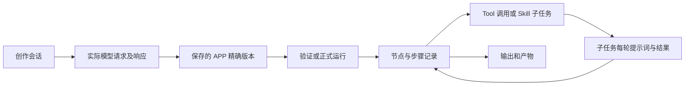

# APP 接口、依赖和提示词存储

2026-10-15，当前实现合同。行为变更见[保存规范](应用保存与执行追踪规范.md)，能力信任见[免验证规范](SkillsTools免验证规范.md)。验收结果独立记录，不以文档代替实际运行。

## 保存、验证、运行

现代 APP 使用 `cd80.app/2`。每次保存固定一个不可变 `versionId` 和 `definitionDigest`。新的版本始终未验证；修改不会覆盖旧版本或自动启用新版。APP 的验证与其中 Skill/Tool 的来源信任是两个层次：官方能力免重复验证，组合出来的新 APP 仍需验证。

| 操作 | 路径（均在 `/desktop/api` 下） | 行为 |
| --- | --- | --- |
| 保存/另存版本 | `POST /asset-apps` | `definition`；更新还传 `appId` 和当前 `revision`，返回未验证版本 |
| 完整包导入 | `POST /asset-apps/import` | 导入预览确认的定义，保存后再验证 |
| 读取详情 | `GET /asset-apps/{appId}` | 可按版本读取定义、缺口、状态和运行绑定要求 |
| 验证保存版本 | `POST /asset-apps/{appId}/verify` | 至少两组不同实际输入及断言，保存每次验证运行 |
| 启用/停用 | `POST /asset-apps/{appId}/enable` | 明确版本、修订号；未通过或执行环境变化时拒绝启用 |
| 正式运行 | `POST /asset-apps/{appId}/runs` | 调用已启用的精确版本，输入与文件授权单独传递 |
| 运行详情 | `GET /asset-apps/runs/{runId}` | 步骤、调用关联、状态、结果和产物 |
| 导出 | `GET /asset-apps/{appId}/export` | 冻结定义、资源及依赖，不携带用户凭据 |

写操作采用 `Idempotency-Key`；工坊会话和策略接口使用请求体 `idempotencyKey`。幂等键绑定请求内容，同键不同内容拒绝。所有个人资源按当前登录账号校验；不能通过提交 owner 字段指定其他人的记录。

## 定义里明确存什么

| 字段 | 含义 |
| --- | --- |
| `name`、`description` | 用户可理解的名称和用途；自然语言路由依据之一 |
| `inputSchema` | 本次调用输入的 JSON Schema，不能包含未授权文件访问捷径 |
| `rules[]` | 各步骤需遵守的固定应用规则 |
| `nodes[]` | 有序步骤，每步明确 `id`、`kind`、`title`、输入绑定与交付约束 |
| `nodes[].kind=tool/skill` | 通过 `componentRef={assetId,versionId}` 冻结本人精确版本；保存后为完整 `component` 快照 |
| `component` | 清单、文件字节、内容摘要、依赖闭包、快照摘要；运行不会偷偷替换为最新版本 |
| `nodes[].kind=code` | `code` 为 `run(payload)` 源码，资源在 `files`；通过隔离执行器运行 |
| `nodes[].task` | Skill 步骤的任务说明，运行时与 APP 固定规则共同传给子代理 |
| `nodes[].inputBindings` | 从本次输入、固定字面量、已完成步骤结果、已授权文件、前一步产物取值 |
| `nodes[].delivery` | 输出 Schema、声明的文件及证据字段；不符合就不能当成功交付 |
| `outputs` | 对已完成步骤输出的明确映射 |
| `gaps`、`parameterization` | 尚未补全的实现/输入说明；缺口不等于已经实现 |

`from=input` 用 `path` 取用户输入；`from=step` 必须指定 `stepId/path`；文件输入与产物输入分别使用 `from=file` 和 `from=artifact`。不会隐式合并全部聊天历史、上游输出或私人文件。完整可导入例子见 `examples/official-history-app/`。

临时生成的 Python 若进入 APP，会保存成该版本的代码节点或组件资源，成为可审阅的固定实现。单次子代理运行临时生成的代码仍属于该次执行证据；只有显式整理并保存成 APP，才进入可复用定义。模型描述“调用某工具”不能替代真实工具调用记录。

## 一轮模型请求如何关联到下一轮

模型本身不承担跨轮持久化。后端先从会话、精确版本及已授权结果构造这一轮消息，再保存实际请求；下一轮从已落库状态构造新消息。

| 存储 | 主要记录和关联 |
| --- | --- |
| `data/agent-platform.sqlite3` | `asset_apps` 当前启用引用；`asset_versions` 不可变定义；`asset_runs` 精确版本及步骤；`asset_artifacts` 产物字节；`asset_requests` 幂等收据 |
| 同一平台库中的创作记录 | `authoring_sessions`、候选、模型请求及私有 trace；保存版本 `authoringProvenance` 关联会话、候选及 trace IDs |
| 同一平台库中的应用工坊记录 | `app_workshop_sessions`、`app_workshop_requests`、`app_workshop_sources`；新增 `app_workshop_model_traces` 保存实际分析、组合、生成请求；会话及版本 `source.modelTraceIds` 串联这些轮次 |
| `data/sub-agent.sqlite3` | `records` 中的 run、`model_trace`、`execution_evidence`、`skill_snapshot`；APP 步骤记录 `skillCallId`，模型轮次通过 `parentRunId/nodeId/skillCallId` 关联 |
| 能力库独立存储 | 精确资产/版本、依赖、调用记录及可信来源授权；APP Tool 步骤的 `invocationId` 关联真实调用 |
| `data/strategy-workshop.sqlite3` | `workshop_objects` 保存规则、个人策略、回测；`workshop_snapshots` 保存代码/行情冻结快照；`workshop_model_traces` 保存匹配与规则改写的实际请求，候选/自定义规则的 `modelTraceIds` 关联各轮 |

策略工坊个人策略保留专用的日频诊断回测合同，通过统一“我的 APP”目录显示；它没有被伪装成可任意执行的 `cd80.app/2` 节点。新增个人策略的定义保存在 `_draftDefinition`，`definitionDigest` 校验完整性；验证状态来自相同保存版本与源码摘要的实际诊断运行。编辑另存新版本并用 `previousAppId` 关联。旧冻结回测版本继续按原快照打开。

实际提示词记录包含发送的 `messages`（system/user 等），并关联模型、会话/阶段和请求状态。应用工坊、策略工坊及子代理 trace 还保留捕获到的模型返回内容；统一创作的私有请求 trace 保存请求体，结果由候选及模型请求状态记录关联，不声称这里保存了逐 token 响应。不只是记录源码中的静态 prompt 常量。接口按账号读取：

- `/authoring-sessions/{sessionId}/model-traces/{traceId}`
- `/asset-apps/{appId}/creator-traces/{traceId}`（归属创建者的生成请求记录）
- `/app-workshop/model-traces/{traceId}`
- `/strategy-workshop/model-traces/{traceId}`
- `/sub-agent-runs/{runId}/model-calls/{callId}`

记录先清理凭据，再有界保存。超过上限时明确 `truncated=true` 并保留脱敏内容摘要和片段，不能声称保留了完整请求。`completed` 表示模型请求结束，不表示内容有效、APP 验证通过或金融结论正确。服务重启中断的调用保留已存请求并标记中断，不自动重跑。旧版本的历史缺失提示词无法事后重建，本次只记录新增调用。

## 自然语言调用

主对话只把当前账号已启用的精确 APP 版本加入可调用目录，包括名称、描述、输入结构与固定规则。模型选择 `invoke_app` 后，服务再次校验版本、启用状态和文件授权，再创建真实运行。自然语言文本应明确应用名、所需输入与希望获得的输出；它不授予账号、文件或网络权限，也不能绕过未验证状态。
