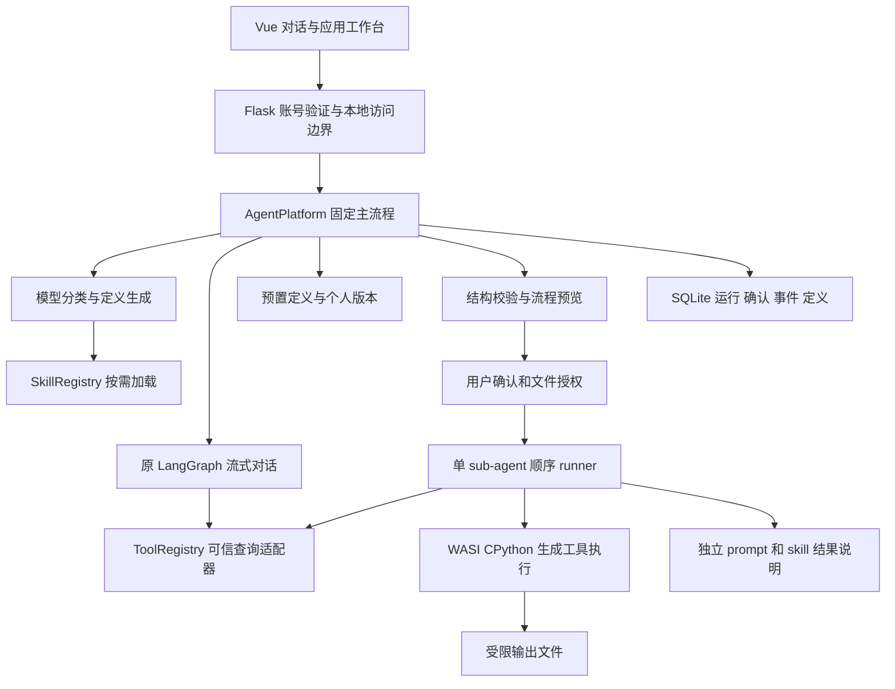

# 成都八零系统开发手册

更新日期：2026-10-13。本文描述第一阶段实际代码结构与协议；本轮共享工具与 Skill 扩展见 [接入手册](工具与Skill接入.md)。产品范围见 [产品手册](产品手册.md)，任务状态见 [开发任务](开发任务.md)，验证证据见 [阶段验收记录](阶段验收记录.md)。

## 1. 架构与模块职责



主 agent 是固定的服务端状态流程；模型只返回分类或定义，不能自行批准、执行或保存。普通聊天继续使用原来的 LangGraph，新增平台由 `AgentPlatform` 编排，不冒称原有三个提示词角色就是应用 agent。

| 文件 | 职责 |
| --- | --- |
| `workbench/auth.py`、`store.py`、`service.py` | 账号会话、账户内业务状态、文件及原聊天 |
| `workbench/graph_runtime.py` | Gitee 流式传输、可取消响应、普通聊天 LangGraph/checkpoint |
| `agent_platform/contracts.py` | JSON Schema 子集、AgentSpec、引用与顺序结构校验；不导入生成代码 |
| `planner.py` | 意图分类、动态定义生成、独立上下文结果说明；有界输入输出及 deadline |
| `repository.py` | SQLite 事务、账户范围、事件、幂等请求、不可变个人应用版本 |
| `service.py` | 生成、缺参、确认、授权、执行、取消、反馈、保存和修订 |
| `executor.py` | 运行时验证、授权输入准备、可信工作进程生命周期、资源限制 |
| `executor_worker.py` / `executor_guest.py` | 可信 Wasmtime 宿主 / WASI 客体入口与内存输出协议 |
| `presets.py` | `csv-summary@1` 定义及内联标准库工具 |
| `routes.py` | 认证 API、只读事件流、账户范围内的产物下载 |
| `useAgentPlatform.js` / `Agent*` 组件 | 应用目录、参数、运行卡、明确审批动作及只读状态观察 |

`create_app()` 注册平台与内建应用；没有运行时不妨碍普通聊天启动，但执行生成代码必须明确失败。

## 2. 主 agent 固定流程

1. 校验会话、用户请求和文件归属；生成/路由只向模型提供文件元信息，不提供数据行。
2. 分类为 `chat`、`clarify`、`invoke` 或 `create`。普通对话返回同一任务 ID 后继续原聊天 SSE；澄清保存已知参数和附件引用供下一轮使用。
3. `invoke` 读取精确版本，校验参数；参数齐全的已保存/预置应用可直接进入执行队列。模型返回不存在的引用会被拒绝。
4. `create` 异步生成完整 AgentSpec；结构有效但缺参数时进入 `awaiting_input`，补齐后生成新的确认绑定。
5. 新定义展示为 `awaiting_confirmation`。用户批准具体绑定后才能执行；拒绝进入 cancelled。
6. 执行前检查额外文件需求，未包含在本次输入授权中的文件进入 `awaiting_authorization`；拒绝不执行。
7. 顺序运行批准的工具，末尾在独立上下文加载 prompt 和 skill，并依据实际工具结果生成说明。
8. 成功后可反馈并选择保存。修改需求创建新运行、新版本及新确认，不修改旧定义或旧产物。

流程预览只进行结构与引用检查，不编译导入或运行生成的工具，不使用样本、mock 或真实数据进行业务计算。文件摘要用于输入绑定，不是数据测试。模型请求本身会有费用。

## 3. 定义与输入契约

真实完整示例见 `presets.csv_summary_spec()`。生成与预置定义使用相同结构；工具与 skill 的内容**内联保存在定义中**，现在也可通过 `registeredTool`、`registeredSkill` 引用跨应用共享目录；引用在预览前解析，工具参数与 Skill 正文随方案保存。

| AgentSpec 字段 | 约定 |
| --- | --- |
| schemaVersion | 字符串 `"1"` |
| id / version / origin | 持久化后有 ID、精确版本及 generated/preset 来源；模型返回的身份会由平台分配/覆盖 |
| name / description / goal | 用途与目标说明；不能当作可信运行结果 |
| prompt | 子 agent 的独立应用指令 |
| inputSchema | type=object 的 JSON Schema 子集，明确参数与 required |
| outputSchema | 平台最终结果对象的结构，不是单个工具的业务返回值 |
| tools | 1–8 个工具定义：生成代码或平台注册工具引用 |
| skills | 0–8 个可选 SkillSpec，工具不依赖 Skill |
| pipeline | 最多 8 个顺序步骤；至少一个 tool，最后恰好一个 model 解释步骤 |
| permissions | `{network:false, files:[输入字段名或文件ID]}`，动态生成应使用字段名 |

生成 ToolSpec 包含 `id/version/code/entrypoint/inputSchema/outputSchema/permissions`，可附 description。`entrypoint` 只能是 `run`，源码必须定义 `run(payload)`。SkillSpec 包含 `id/version/content/requiredTools`；requiredTools 只能引用本定义中的工具。

平台注册工具使用 `registeredTool` 替代 `code`，不允许文件权限。Skill 可使用 `registeredSkill`，正文从真实目录加载并冻结，不能由模型伪造。参数 schema 漂移或步骤超过注册工具调用上限时拒绝执行/预览。

工具步骤使用 `{id,kind:"tool",tool,inputFrom}`；解释步骤使用 `{id,kind:"model",purpose,inputFrom}`。输入引用只允许 `run.input` 或 `steps.<之前步骤ID>.output`。单引用直接传值，多引用包装为 `{inputs:[...]}`。不支持循环、递归、并行、任意模型工具派发或自动修复。

支持的 schema 字段为 type、properties、required、additionalProperties（仅布尔）、items、enum、const、description、title、default、minimum/maximum、minLength/maxLength、minItems/maxItems。不支持 `$ref`、组合 schema、远程依赖或任意执行钩子。默认值是表单提示，后端不会把缺失必填参数隐式补齐。

### 文件和工具输入

用户提交业务参数，如 `{fileId,groupBy,valueColumn}`，并在 `fileIds` 中显式选择输入文件。不能提交 `filePath/filePaths/outputDir`。生成 Python 的工具输入通过 schema 校验后，由运行器注入（注册查询工具不注入这些路径）：

```text
filePath  = /input/<本次 fileId>（该文件已授权且可访问时）
filePaths = {文件ID: /input/文件ID}
outputDir = /output
```

权限中的 `files:["fileId"]` 引用输入字段；`filePath` 是注入路径，不是权限字段。额外文件还须属于当前账户，且在实际内容读取前取得用户授权。每次运行累计最多 8 个文件。

### 结果与产物

工具返回 JSON 可序列化对象，其业务字段受 `tool.outputSchema` 校验。如果写文件，返回 `artifacts:["summary.csv"]` 等文件名；声明的文件必须实际存在。平台另分配不可预测的产物 ID、字节数、SHA256、媒体类型及所属步骤。

运行最终结果为：

```json
{
  "explanation": "根据实际工具结果生成的说明",
  "artifactIds": ["平台生成的产物ID"],
  "stepOutputs": {"步骤ID": {"业务输出": "示例"}},
  "csvArtifactId": "存在CSV时才出现"
}
```

该对象按 AgentSpec.outputSchema 校验。总额、行数等放在工具输出中，不能错误地要求它们位于最终结果顶层。失败时没有整体成功结果，但此前已完成步骤及可下载产物保留。

## 4. 模型与 skill 的实际使用

Planner 使用专用 GiteeProvider，首版配置为 max_tokens=8192、reasoning_effort=low。分类和生成请求使用 `response_format:{type:"json_object"}`，结果说明及普通聊天仍使用文本输出；没有格式错误后的隐式回退或重试。普通聊天的默认请求不受该生成预算影响。只有模型 `content` 作为结果处理，推理内容不充当业务结果。

分类仅接收最近有限文字历史、候选应用元信息和明确参数；附件正文从分类历史中移除。生成接收目标、参数、文件元信息，以及可用工具 schema 和 Skill 元信息。修订可以接收经过契约校验的 baselineSpec。工具代码由模型生成，平台不会在失败后替换为预置实现。

解析接受一个 JSON 对象或包住该对象的单一 json 代码围栏；仅对 JSON 字符串内原始 LF/CR/TAB 做保持字符串含义的转义兼容。分类中未使用的空字段视为省略，对应分支的必需字段仍严格检查。杂文、多对象、重复键、非有限常数、不支持的协议拒绝。结构化输出并不替代契约校验；不会自动修改 Python 算法或调用模型重试。生成整体 deadline 默认 300 秒，分类最多 120 秒；已建立的响应在截止后真实中断。

结果解释使用新的子 agent 上下文：平台约束 + 批准的 prompt + 实际 skill.content + 本次参数元信息与工具输出，不复制主 agent 的整段对话。运行保存 skill ID、版本和内容摘要；工具步骤保存源码摘要、版本、实际输出和日志。这证明内容参与了本次运行，不能据此声称模型始终完全遵循了每一条指令。

## 5. 隔离执行边界

运行生成 Python 的安全边界是 WebAssembly/WASI 能力隔离。外层可信 Python 子进程负责启动与终止 Wasmtime；新建目录或 Python venv 本身不作为安全沙箱。

- 固定 Wasmtime 49.0.0、WASI CPython 3.15.0；安装脚本校验下载摘要并自检。运行前校验本地运行时文件。
- 只挂载已授权输入和可信程序/标准库的只读目录。宿主环境变量、模型密钥、网络 socket 和进程创建不暴露给客体。
- `/output` 是客体内存中的文件集合，不挂载可写宿主目录。只支持平面 ASCII 安全文件名，通过 open/io.open/Path.open 写入；不使用 mkdir、目录扫描、os.open。
- 默认单工具 15 秒、线性内存 128 MiB、输入总计 16 MiB、输出总计 4 MiB、日志 64 KiB，另有 fuel 计算量限制。平台产物进一步限制每文件 2 MiB、每工具 16 个。
- 运行总时限 180 秒；取消或超时信号到达工作进程并终止执行。运行时不可用时明确失败，无宿主 Python 回退。

首版只有 Python 标准库；pandas、pip、外部行情请求以及复杂金融数值生态需在下一阶段另行设计。

## 6. 状态、确认与持久化

| 状态 | 含义与后续动作 |
| --- | --- |
| generating | 正在生成定义，可停止 |
| awaiting_input | 缺参数；补齐并生成新的流程确认 |
| awaiting_confirmation | 只展示流程；确认后排队，拒绝取消 |
| queued | 已有应用明确调用或新方案已确认，等待运行器接手 |
| awaiting_authorization | 等待额外文件访问决定；未读取额外内容 |
| running | 实际执行顺序步骤 |
| cancelling | 已收到停止请求，等待执行方终止 |
| succeeded / failed / cancelled / interrupted | 终态；保存仅允许 succeeded，修改/重跑须用户新动作 |

Run 保存 ID、taskId（可空）、mode、goal、spec、input、文件元信息、allowedFileIds、steps、artifacts、approvals、executionPerformed、output、error、feedback 和时间。页面以服务端状态为准，轮询/SSE 都不触发执行。

确认记录含 `id/kind/status/bindingDigest`。execute 绑定定义、输入、文件摘要及允许文件；access 绑定额外资源；save 绑定定义版本摘要。确认请求携带 bindingDigest 和 idempotencyKey，过期绑定/相同键用于不同动作返回 409。保存和执行是不同确认。

SQLite `agent-platform.sqlite3` 将 runs/events/agents/requests 持久化，查询和变更均校验 owner。创建、确认、保存使用事务保护；重复请求返回原结果，不重复启动。最多同时运行 2 个生成/执行任务；超额明确失败，不隐式排队重试。

重启时将遗留 generating/queued/running/cancelling 标为 interrupted，并标记未完成步骤。待输入、待确认、待授权保留，刷新可以恢复；不会自动执行旧任务。浏览器断开只停止观察，不等于用户停止运行。

## 7. HTTP API

以下均位于 `/desktop/api`，使用现有 HttpOnly 会话 cookie。未认证拒绝访问；文件、运行、定义和产物都按账户过滤。错误体为 `{error,code?}`。

| 方法与路径 | 请求/返回 |
| --- | --- |
| GET `/agent-runtime` | 执行器可用性、资源限制、平台顺序执行能力 |
| POST `/agent-dispatch` | `{message,taskId?,projectId?,fileIds?,idempotencyKey?}`；返回 intent、taskId，必要时 question 或 run；新任务可归入本人项目 |
| POST `/agent-dispatch/<requestId>/cancel` | 停止该识别请求；若已产生 run 则取消对应运行 |
| GET `/agents` | `{agents:[{agentRef,spec,personal}]}`；预置与个人定义去重 |
| GET `/agents/<id>/versions/<version>` | 精确版本定义 |
| POST `/agents` | `{runId,idempotencyKey,approvalId?,bindingDigest?}`；显式保存成功运行的定义，返回 agentRef/spec |
| GET `/agent-runs?taskId=...` | 当前账户最近最多 100 次运行，可按所属任务筛选 |
| POST `/agent-runs` | `{mode,goal?,agentRef?,input,fileIds,taskId?,revisionOf?,idempotencyKey}`；返回新运行，状态异步变化 |
| GET `/agent-runs/<id>` | 读取一次运行的最新完整记录 |
| POST `/agent-runs/<id>/input` | `{input,fileIds?}`；补齐待输入参数并重新生成确认 |
| POST `/agent-runs/<id>/approvals/<approvalId>` | `{decision:"approve"或"reject",bindingDigest,idempotencyKey}` |
| POST `/agent-runs/<id>/feedback` | `{message}`；记录反馈，成功且尚未询问保存时产生 save 确认 |
| POST `/agent-runs/<id>/cancel` | 取消对应生成、等待或执行 |
| GET `/agent-runs/<id>/events` | 只读 SSE，支持 Last-Event-ID 或 after 游标 |
| GET `/agent-artifacts/<id>` | 账户内产物附件下载；禁止内联执行 HTML/脚本 |

`create` 必须有目标；`invoke` 必须有精确 agentRef 和完整参数。revisionOf 只能用于 create，原运行须已有定义且不在实际执行中。预置修订创建新应用；已生成应用修订保留 ID、产生新的不可变版本。

事件包括 run.created、agent.plan_ready、run.input_required、approval.required/decided、run.started、step.started/completed、run.completed/failed/cancelled、agent.saved 等。SSE 的 done 仅表示本次观察结束，可能仍是等待确认，不能解释为执行成功。

## 8. 工作台与复用

默认主助手模式先调用 dispatch；普通对话分支继续使用已有 chat SSE。用户可以明确切换普通对话模式。应用页面列出预置与当前用户个人应用，并按 schema 提供文件选择、文本/数值/枚举表单；复杂嵌套参数提供 JSON 输入。

新生成流程显示输入、顺序步骤、预期输出及高级定义详情。按钮分别执行确认、授权、停止、反馈、保存或修订；状态刷新不发送这些动作。保存后的下一次参数表单文件为空，不能默认带入上一份文件。拒绝保存不会删除本次结果，以后仍可明确选择保存。

前端按账户、任务和视图维护观察请求，切换时清空并丢弃迟到响应；本地只保留按账户区分的最近页面/任务位置，不把执行状态当作浏览器事实。

## 9. 预置样例与验收

`csv-summary@1` 输入 fileId、groupBy、valueColumn，可选 aggregation=sum。UTF-8（含 BOM）逗号 CSV 有表头；分组键升序输出，Decimal 求和，返回 summary.csv 与有界摘要。空值、非有限数、缺列、重复表头及记录列数异常均失败。

预置工具限制 10 万行、5000 组、分组键 80 字符、数值 50 位有效数字及指数 [-28,28]。完整结果导出 CSV，模型仅接收前 20 组摘要和总计。生成应用是否采用同样业务上限，以具体批准定义为准；运行时总资源限制始终生效。

开发者测试、真实模型验收和浏览器验收分别记录。测试输入的精确期望值见 [开发任务](开发任务.md)。代码改动后先跑相关测试，再跑完整回归；通过命令与限制集中记录在 [阶段验收记录](阶段验收记录.md)，不在本手册复制易过时的测试数量。
